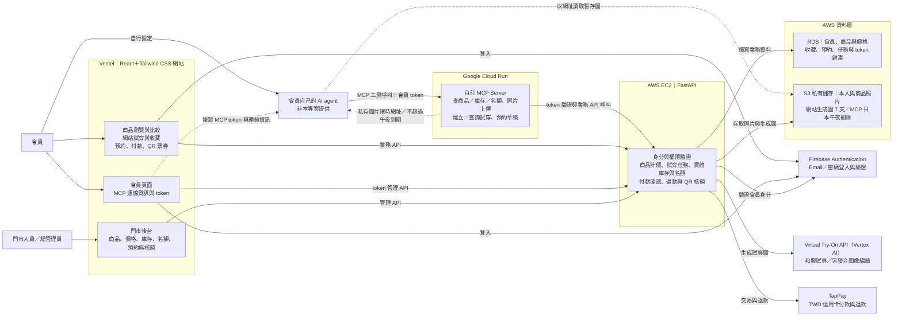

# KINU TABI｜功能與技術規格

圖表依據：[最新系統架構圖](./updated-mermaid-diagram-2026-10-16/01-system-architecture.drawio.png)及[最新會員體驗流程圖](./updated-mermaid-diagram-2026-10-16/02-member-experience-flow.drawio.png)，可編輯來源與 PNG 同目錄。圖中省略的交付期限、細部規則與驗收要求仍依本文保留。

> 本文件記錄同一套正式產品的功能驗收、資料、介面、品質與安全條件。工作階段只界定交付順序，不降低已交付功能的正式服務要求；產品範圍見[產品與體驗規劃](./01-product-experience.md)。

更新日期：2026-10-16。產品規則與本文件已依本次討論同步；實作順序見[期中實作與報告參考](./05-midterm-implementation-guide.md)。

## 快速導讀

系統以 RDS 商品與門市資料、Vertex AI 試穿、Firebase 會員登入、TapPay 付款及門市核銷為目標。10/12 階段一以商品與預約骨架為目標；10/26 階段二以會員、真實試穿、即時名額、實體庫存與 10 分鐘付款暫留、TapPay 新台幣付款、正式預約、退款、QR 核銷、門市後台及正式可用的 MCP Server／會員 token 為目標；11/16 階段三完成行事曆、最近可預約日期、FAQ 搜尋、繁體中文／英文／日文語系切換，以及預約體驗前提醒，並修正既有流程的品質問題。日期為目標，功能須通過驗收才開放。任何階段啟用照片上傳、即時名額或付款時，對應的伺服器驗證、資料保護與安全要求須一同完成。商品圖與預製模特兒穿搭圖是正式商品展示素材；查看不計生成次數。預製圖或模擬回應不得冒充即時 AI 生成或正式交易完成證據。

## 主要功能需求

正式付款、真實圖片生成、門市後台、方案比較、收藏、QR 與登入同步均須於 10/26 前完成、驗收並正式上線。功能必做不等於使用者必經；生成與收藏維持選用，直接選方案預約仍須可用。

### FR-P-01 方案探索

使用者可依地區、門市、同行者、風格、類型、預算、包含服務與日期篩選。系統須顯示目前條件、結果數並支援一鍵清除。

驗收：選擇「京都＋情侶＋含髮型」後，只顯示同時符合三項條件的方案；重新整理後可由 URL 還原條件。

### FR-P-02 和服比較與外拍方案比較

- 和服比較：會員從收藏中勾選 2～3 個和服方案，比較圖片、類型、目前方案價格、各已選配件加價及總價；第 4 個不可直接加入。
- 外拍方案比較：在同地點、同和服的前提下，比較寺廟與價格較高的櫻花樹等場景之總價、包含服務與可預約日期；共同門市資訊放上方。選定場景直接帶入後續，不重複選擇或計價。
- 每件和服的商品圖與預製模特兒穿搭圖關聯同一商品 ID，可切換查看，未登入亦可看；展示圖上的非內含配件標示另購。

### FR-AI-01 照片上傳與同意

所有即時生成（含商店模特兒）須登入；網站與 agent 專用上傳工具皆可提供本人照片。專用上傳流程先驗證會員並記錄明確照片處理同意，再接收原圖並建立本人照片 ID；agent 附圖本身不等於同意傳送至本站。後續試穿只使用本人照片 ID 或商店模特兒 ID，不回傳本人原圖。

未同意或未上傳者不能生成本人的試穿圖，仍可選商店模特兒或直接預約。token 連線授權、照片處理同意與每次生成確認互相獨立。JPEG、PNG、HEIC 規格依 SRS-F-02；越權、未登入或缺少必要同意的上傳須由後端拒絕。

### FR-AI-02 照片品質檢查

本人照片檢查單人正面全身、完整及光線；商店素材須審核。失敗指出修正方法並保留搭配，可重傳、改用模特兒或跳過，不以未上傳本人照片阻擋預約。

### FR-AI-03 真實和服試穿與場景合成

- 和服商品圖、預製模特兒穿搭圖、AI 人物來源照分開記錄。首次試穿呼叫 Google Cloud Virtual Try-On API（Vertex AI），輸入人物與和服商品圖；可選配件須呈現於穿搭效果，配件與背景編輯能力須另行整合驗證。
- 外拍場景優先使用目前人物、和服與配件的預覽圖＋場景照再次合成；無來源圖時先生成穿搭，再另行確認場景生成，兩次各計 1 次。
- 使用商店模特兒時，可直接用同件和服的預製穿搭圖，即使含未選配件也可保留，但須揭露名稱、目前加價與「加入搭配」按鈕；未選者不列入價格／庫存保留。無可售對應的裝飾標示僅供示意、不提供選購。
- 加入或移除圖中已有的示意配件，只更新目前搭配與價格，不自動重生、不計次；移除後圖仍有配件，標示未選。修改已保存收藏須另行確認更新。
- 本人形象不自動換成模特兒；本人來源已刪、到期或與搭配不符，先確認重生或由使用者改選模特兒。
- 網站每會員每日 5 次（穿搭與場景共用），MCP 每日 3 次，兩者分開；日本時間 `Asia/Tokyo` 00:00 重設。每次生成都確認，查狀態不計次，不以重送同一請求重複扣次。
- 正常、生成中、成功、失敗、額度不足、來源失效皆有回饋；保留選擇，額度不足或 API 失敗可跳過直接預約。

### FR-AI-04 收藏與跨裝置同步

收藏、試穿與比較皆選用，可從商品列表、試穿或收藏直接選方案預約，不要求先收藏或生成。會員可收藏商品方案、所選配件與可選生成圖，支援跨裝置同步；未登入按收藏跳登入後接續，不提供匿名本機收藏。

生成時建立商品、方案、人物來源及已選／示意配件關聯；收藏沿用 ID，不靠看圖反查。網站生成圖保存 7 天，到期或刪除改用原商品圖，保留搭配與場景資料。刪除原圖、取消收藏、刪除生成圖互不連動。統一使用目前 TWD 售價，不顯示收藏時價格或新舊價差；付款前後端再確認，已付款訂單金額固定。

### FR-B-01 多步驟預約

使用者可選門市、日期、時段、人數、各旅客方案、加購與聯絡資料。每筆預約限 1～3 位旅客，各自選擇方案並共用同一門市、日期與時段；前端人數選擇及旅客清單最多 3 人，達上限時停用新增並顯示「每筆預約最多 3 人」。返回前一步不可遺失資料。

驗收：無效時段不能選；門市更換後若原方案不適用，必須提示並要求重新選擇。1～3 人可各自配置方案；無法新增第 4 人，後端也須拒絕繞過前端送出的超額旅客清單；共同時段名額不足以容納全員時，不得進入付款。

### FR-B-02 即時計價

系統按每筆 1～3 位旅客各自的方案、加購、人數優惠與線上折扣計算小計、折扣及總計；摘要列出每位旅客明細，由預約會員以一筆交易支付整筆總額。

驗收：任何會影響價格的操作須立即更新摘要；送出前顯示幣別及所有費用。

### FR-B-03 預約成立

後端確認 TapPay 付款成功且整筆商品與名額暫留有效，轉正式保留並成立預約後，顯示唯一預約編號、會員 QR 票券、門市資訊、日期時段、旅客與價格摘要，並寄送與預約資料一致的確認信。

驗收：重複點擊送出不得產生兩筆預約。


## 系統架構與部署

| 元件 | 部署／服務 | 職責 |
|---|---|---|
| React＋Tailwind CSS 前端 | Vercel | 商品瀏覽、試穿、預約、會員 MCP token 與門市後台畫面 |
| FastAPI 後端 | AWS EC2 | 請求驗證與業務邏輯 |
| 自訂 MCP Server | Google Cloud Run | 供會員自己的 AI agent 連接，提供和服、試穿與預約相關工具 |
| 關聯資料庫 | AWS RDS | 儲存會員業務資料、商品種類與價格、試穿任務及預約紀錄 |
| 圖片儲存 | AWS S3 | 儲存使用者照片、和服照片與生成的試穿圖片 |
| 身分驗證 | Firebase Authentication | 會員註冊、登入與身分驗證 |

前端向 FastAPI 後端取得商品、試穿與預約資料，會員登入後可在帳號頁取得 MCP token 及連線資訊，供自己選用的 AI agent 連接 Cloud Run 自訂 MCP Server。本專案不部署或提供 Agent 模型與內建選物助手。MCP 工具的請求仍由 FastAPI 驗證會員身分、資源權限與業務規則；會員註冊、登入與憑證由 Firebase Authentication 處理，RDS 保存會員的業務資料。

商品圖與預製模特兒圖可正式展示，模擬生圖僅限開發測試。對外開放本人照片上傳、試穿或正式預約時，須同步滿足本文件的資料保護、名額與送單驗證要求。

### Google Cloud Virtual Try-On API 與圖像編輯邊界

Try-On 由 FastAPI 呼叫 Google Cloud Virtual Try-On API（Vertex AI），以本人／商店模特兒照及和服商品圖驗證真實試穿，不能以預製圖替代。正式 API 的模型、地區與參數依部署時官方文件及專案可用性設定，不在規格鎖定過期的預覽模型名稱。

配件穿戴與背景合成是既有必做需求，但不得假定只改 prompt 就能由 Virtual Try-On 單一呼叫完成。10/15～10/17 先用和服、包包、髮飾及寺廟／櫻花素材驗證；必要時由 FastAPI 串接經驗證的 Google Cloud 圖像編輯能力。確切編輯模型與內部步驟待技術驗證記錄；未通過不宣稱完成，不擅自縮減需求。用量按使用者確認的生成任務計算，內部供應商呼叫與成本另記；穿搭與場景任務各需確認、各計 1 次。

參考：[Google Cloud Virtual Try-On 官方指南](https://docs.cloud.google.com/gemini-enterprise-agent-platform/models/capabilities/generate-virtual-try-on-images)。官方描述以人物照及服裝產品圖生成試穿，配件與場景能力需實測驗證。

### 外部服務整合

- **TapPay**：第一版優先提供信用卡付款。全站標價、計價、訂單與退款均使用 TWD，TapPay 正式收款也設定為 TWD；結帳前顯示 TWD 應付總額。FastAPI 後端確認付款成功且商品與名額暫留有效、轉正式保留後才成立正式預約並產生 QR 票券。付款失敗保留選擇供重試；重複通知或重送不得重複扣款、建立預約或票券。取消時間以日本門市當地時間計算：距預約開始超過 7×24 小時全額退款；剩餘 7×24 小時或更短不退款。由授權後台人員發起退款並記錄 TapPay 處理結果。天候使室外攝影不可行時，退還單獨加購及方案內含的全部攝影費用，後台保留可計算明細，和服租借照常進行。
- **Google Cloud Virtual Try-On API（Vertex AI）**：真實人物＋和服圖片試穿；配件及場景依前述整合邊界驗證。網站會員生成圖保存 7 天、每日最多 5 次；MCP 圖當天日本午夜刪除、每日最多 3 次；原圖保存至使用者刪除、替換或帳號刪除。
- **Firebase Authentication**：使用 Email 與密碼註冊、登入；註冊時驗證一次 Email，正式付款前須完成驗證，後續登入不必每次收驗證碼。FastAPI 依登入身分限制收藏、會員票券及管理後台資料的存取。
- **帳號管理**：提供密碼重設；付款暫留、未體驗且未取消預約、付款待確認、未歸還或退款處理中／失敗未解決時禁止刪除。安全解除暫留、取消並完成退款及履約後才允許。已完成歷史交易不阻擋；本站資料、外部副本與備份範圍依下方資料保留及產品規劃。

### 功能驗收

| 功能 | 驗收條件 |
|---|---|
| 和服比較 | 會員從收藏選 2～3 個方案比較目前 TWD 方案、配件及總價；另提供同地點同和服的外拍場景比較，不重複計價。 |
| 攝影與相片加值服務 | 每筆預約選一種拍攝形式；室外拍攝才可選景點與隨行攝影師。每年東京櫻花景限 3/19～4/3、京都限 3/24～4/8，起訖日包含在內，仍須符合當年開放狀態。攝影分上午 09:00 與下午 13:00 場次（日本時間，可由門市調整），各選項 TWD 加價及每場容量由第二階段後台維護，即時顯示並計入總價；無效或額滿組合不可送出。天候取消室外拍攝時不改拍、退還單獨加購及方案內含的全部攝影費用，制式相簿備貨不扣減退款，租借仍有效。 |
| 造型收藏 | 須登入，可直接收藏商品或生成圖及搭配；已選與示意配件分開。取消收藏不刪圖，圖到期／刪除保留搭配。已存收藏修改須確認。 |
| 登入與同步 | 收藏、進入預約、上傳、任何即時生圖及私有資料須登入。返回原選擇；生成需再次確認。無匿名收藏；手機與電腦讀同一後端資料。 |
| 正式付款與預約 | TapPay TWD 信用卡；驗證後端付款結果，商品及名額有效轉正式保留才成立預約、QR 並寄信。冪等回呼／查核，不信任前端返回。 |
| 付款幣別與退款 | 第一版優先提供信用卡；全站標價與實際收款皆為 TWD，結帳前顯示 TWD 應付總額；會員提出取消時即時計算並顯示 TWD 預估可退金額。僅授權後台人員可發起退款；會員可查看處理中、完成與失敗狀態。 |
| 會員 QR 票券 | 每筆一張，QR 每 5 分鐘更新且無個資。會員本人在指定門市經店員驗身分、後端連線一次核銷；部分未到場記錄不拆票。日本時間開始後 30 分鐘（含）可報到；先記錄報到避免排隊誤逾期。取消、核銷或逾期未報到失效；攝影部分退款不影響租借票券。 |
| 門市管理後台 | 門市限所屬預約、報到、核銷、接待／攝影名額與庫存出借歸還整備；總管理員管所有商品、價格、庫存及調撥；退款須授權，操作留稽核。 |
| 自訂 MCP Server | Cloud Run 工具透過 FastAPI 查和服、庫存、名額，上傳已同意本人照、建立／查詢試穿及本人預約草稿。每日 3 次、同時 1 個，日本午夜刪圖且不入收藏；token 規則見工具邊界。付款、取消、退款、核銷不經 MCP。 |


## 目標系統架構圖

下圖呈現三個功能階段完成後的目標架構與主要功能分工；不是目前已上線功能的聲明。



會員自行選擇並使用外部 AI agent；本專案僅提供 MCP Server、會員 token 與連線資訊，不提供 Agent 模型或網站內建選物助手。MCP 工具涉及資料或預約時仍由 FastAPI 驗證會員身分與業務規則；生成圖由 MCP 回傳不超過圖片到期時點的私有圖片限時網址供外部 agent 顯示，不回傳本人原圖，圖片保存及存取時限依下方 MCP 規則。會員頁面須告知外部 agent 可能依其服務規則保留對話或圖片副本，本站無法刪除外部副本。預製穿搭圖可正式展示，但不冒充即時生成結果。

### MCP token 與工具邊界

10/26 須完成 Cloud Run 端點與外部 agent 實際連線，所有工具經 FastAPI 驗證擁有權及業務規則；商品、庫存、名額、照片上傳、生成建立／查詢與預約草稿串接真實後端。

- Email 驗證後才可建立 token；每會員同時一個有效 token，只顯示一次，90 天到期。伺服器只存雜湊、擁有者及建立／到期／撤銷時間；重建立即撤銷舊 token，刪帳立即撤銷，不等待備份清除。
- 網站上傳使用會員登入憑證；agent 上傳使用專用工具與有效 token，明示處理說明、取得明確同意後才傳原圖至後端。單純在對話附圖不算同意。只有專用上傳流程傳原圖，試穿工具使用本人照片 ID 或商店模特兒 ID，不回傳原圖。
- 工具查詢／建立任務不授權管理員操作；建立本人草稿後回網站登入、確認商品／庫存／名額／TWD 價格，進入付款才暫留 10 分鐘。MCP 不正式付款、取消、退款或核銷。
- 每會員每日 3 個生成任務、同時最多 1 個；與網站每日 5 次分開，日本時間 `Asia/Tokyo` 00:00 重設。先穿搭後場景各確認、各計 1 次；查詢既有任務不重新生成。每次生成均須確認，token 不取代照片同意或生成確認。
- MCP 圖私有 S3 暫存，不建立會員收藏；生成當天結束的日本時間 00:00 刪除，不保存滿 24 小時。限時 URL 不得超過圖片刪除時點；原圖保存規則不因 MCP 生成改變。網站生成圖仍保存 7 天。
- 限時 URL 的具體有效長度與到期後是否重發，產品最新版未另定案；不得沿用舊的「10 分鐘後禁止重發、1 小時內刪圖」政策覆蓋午夜保存規則。實作前確認存取政策；不要為單純查結果自動重生扣次。
- 告知外部 agent 可能保留對話、上傳原照與結果副本，本站刪除不會同步移除外部副本。會員頁顯示時區、剩餘額度、到期時間與連線資訊。

## 角色與權限

| 角色 | 權限 |
|---|---|
| 匿名訪客 | 瀏覽商品與預製圖、選和服與配件、比較外拍方案、查價格及公開時段；不得收藏、進入預約、上傳本人照或即時生成 |
| 已驗證顧客 | 本人照片同意後由網站或 agent 上傳；確認後試穿／場景生成；收藏與跨裝置同步、本人預約與 QR；Email 驗證為付款及 token 建立必要條件 |
| 門市人員 | 依授權管理所屬門市預約、本人報到核銷、名額、庫存出借／歸還／整備；不改其他門市庫存或售價 |
| 總管理員 | 管理所有商品、價格、門市、預約、庫存及調撥，退款另驗授權；變更留稽核且不損害既有預約 |

所有顧客資源必須以擁有者或一次性安全查詢憑證授權，不得僅依序號猜測存取。


## 資料模型

### 核心實體

#### Store

- `id: UUID`
- `slug: string`
- `city: TOKYO | KYOTO`
- `name: LocalizedText`
- `address: LocalizedText`
- `latitude/longitude: decimal`
- `timezone: string`
- `openingHours: json`
- `languages: string[]`
- `active: boolean`

#### Plan

- `id: UUID`
- `slug: string`
- `name/summary/description: LocalizedText`
- `audience: enum[]`
- `kimonoType: enum`
- `styleTags: enum[]`
- `durationMinutes: integer`
- `basePrice: integer`，以整數新台幣元儲存，與 TapPay 的 TWD 金額單位一致。
- `currency: TWD`
- `onlinePrice: integer?`
- `includedItems: json`
- `storeIds: UUID[]`，正式實作使用關聯表。
- `active: boolean`

#### AddOn

- `id: UUID`
- `name: LocalizedText`
- `price: integer`
- `applicablePlanIds/applicableStoreIds`
- `capacityCost: integer`
- `active: boolean`

#### Outfit

- `id: UUID`
- `planId: UUID`
- `name: LocalizedText`
- `kimonoAssetId/beltAssetId/hairAssetId/accessoryAssetIds`
- `styleTags/colors: string[]`
- `active: boolean`

#### TryOnSession

- `id: UUID`
- `ownerId: UUID`
- `source: WEBSITE | MCP`
- `sourcePhotoKey: string?`
- `consentVersion: string`
- `consentedAt: datetime?`，本人照片才要求對應有效同意。
- `status: CREATED | UPLOADED | VALIDATING | READY | GENERATING | SUCCEEDED | FAILED | DELETED`
- `failureCode: string?`
- `expiresAt/deletedAt: datetime?`

`expiresAt` 可用於工作階段或任務狀態，不作為本人原圖的自動刪除期限；原圖刪除只由使用者刪除或重新上傳觸發。

#### SavedLook

- `id/ownerId/productId/planId: UUID`
- `outfitId: UUID?`、`tryOnSessionId: UUID?`、`generationId: UUID?`；直接收藏商品不要求生成。
- `selectedAccessoryIds/illustrativeAccessoryIds: UUID[]`、`scenePlanId: UUID?`
- `version/createdAt/updatedAt/deletedAt`

生成圖獨立於收藏，取消收藏不刪生成圖；網站圖到期／刪除仍保留商品、方案、配件與場景，改顯示商品圖與狀態。原圖刪除也不連動生成圖。價格依目前商品資料計算，不保存為收藏時固定報價。已存收藏須確認才更新搭配。

#### ProductAsset／PersonPhoto／GenerationJob

- `ProductAsset`：商品 ID、類型（商品圖／預製穿搭圖／配件圖／場景照）、私有儲存鍵及圖中商品／示意配件 ID。
- `PersonPhoto`：本人／商店模特兒類型、擁有者（本人照必填）、同意版本／時間、儲存鍵、刪除狀態。
- `GenerationJob`：擁有者、來源 WEBSITE／MCP、類型 TRY_ON／SCENE、人物照片或來源圖 ID、商品／方案、已選與示意配件、場景 ID、供應商／模型／呼叫與成本紀錄、狀態、確認與冪等鍵、建立／完成／到期／刪除時間。
- 網站圖 `expiresAt = completedAt + 7 天`；MCP 圖在完成當天結束的日本午夜到期。稽核紀錄不保存照片內容。
- `GenerationUsage`：會員、來源、`Asia/Tokyo` 日鍵及原子計次，避免跨裝置繞過額度；同一冪等請求不重複扣次。

#### InventoryItem／InventoryAllocation／RentalRecord

- `InventoryItem`：唯一實體編號、商品／款式、門市、狀態 AVAILABLE／ON_LOAN／CLEANING／MAINTENANCE／LOST／INACTIVE；配件可用數量模型，但須防同期間超額分配。
- `InventoryAllocation`：商品或配件數量、預約／暫留 ID、租借起訖及整備截止、HELD／RESERVED／RELEASED、hold 到期時間；同件商品重疊期間不可重複分配。
- `RentalRecord`：實際交付庫存、出借／歸還／整備完成時間、執行店員與異常處理。
- `Payment`／`PaymentEvent`／`Refund`：交易編號、驗證狀態、整數 TWD 金額、冪等事件、回呼／查核及退款結果；回呼內容依遮罩政策保存，不留卡號或 token 原值。
- `Voucher`／`CheckIn`：預約 ID、動態 QR token 雜湊與時效、本人核對、報到／核銷時間與店員、缺席旅客；每筆只能成功核銷一次。
- `MCPToken`：雜湊、會員、建立／到期／撤銷時間；`DeletionRequest`：阻擋原因、刪除進度及備份清除截止，不保存已刪照片或多餘個資。

#### AvailabilitySlot

- `id: UUID`
- `storeId: UUID`
- `startsAt/endsAt: datetime`
- `capacityTotal/capacityHeld/capacityBooked: integer`
- `status: OPEN | CLOSED`
- `version: integer`，支援併發控制。

攝影資源另依門市、日期及上午 09:00／下午 13:00（日本時間）場次管理名額與價格；門市可在後台調整場次開始時間。第二階段由商家在後台維護各項 TWD 價格及容量；和服預約與攝影資源均須在付款前重新確認。

#### Booking

- `id: UUID`
- `bookingNo: string`，不可推測的公開識別碼。
- `storeId/slotId: UUID`
- `status: DRAFT | HELD | PAYMENT_PENDING | CONFIRMED | CANCELLED | COMPLETED | NO_SHOW`；僅付款確認成功且整筆商品及名額暫留有效、轉正式保留後可轉為 `CONFIRMED`。
- `contactName/contactEmail/contactPhone`
- `locale: string`
- `currency: TWD`
- `subtotal/discount/total: integer`
- `policyVersion/agreedAt`
- `idempotencyKey: string`
- `holdExpiresAt/createdAt/updatedAt`

每筆 Booking 對應 1～3 筆 BookingGuest，代表整筆預約的全部旅客；後端新增或更新旅客時須驗證此限制。此上限不代表門市場次的總容量。

#### BookingGuest

- `id: UUID`
- `bookingId/planId/productId: UUID`
- `inventoryAllocationIds: UUID[]`
- `displayName: string?`
- `guestType: ADULT_FEMALE | ADULT_MALE | CHILD`
- `savedLookId: UUID?`
- `unitPrice: integer`
- `addOns: BookingGuestAddOn[]`

### 資料保留

- 本人原圖：保存至自行刪除、重新上傳替換或帳號刪除，不自動到期；刪原圖不連動收藏或生成圖。
- 網站生成圖：完成後 7 天到期，可提前刪除；取消收藏不刪圖，刪圖／到期保留收藏資料並改顯示原商品圖及狀態。重生須確認、檢查本人原圖與同意，計入當日額度。
- MCP 圖：生成當天結束的日本時間 00:00 刪除，不進會員收藏，不適用網站 7 天；不得因 URL 到期改成另一保存政策。
- 預製商品／模特兒素材：屬商店素材，與會員原圖分開；不因會員刪除而刪商店商品與庫存。
- 未完成預約草稿：7 天，不保留庫存；已付款訂單金額固定，不隨商品調價。
- 帳號刪除：付款暫留、付款待確認、未取消且未體驗預約、未歸還、退款處理中或失敗未解決時阻擋。後端確認無未結事項後，依產品規劃移除本站會員照片、生成圖、收藏、預約及付款退款明細，刪登入帳號、立即撤銷 token；外部服務副本不保證同步刪除。
- 備份：刪帳後最遲 10 天輪替清除相關資料，不供一般查詢；還原時重套刪除紀錄。必要保留資料的範圍、用途及清除期限須在確認刪除前明示；不擅自承諾外部交易平台資料一併刪除。
- 庫存歷史解除會員關聯，不破壞商店庫存及其他會員預約；稽核只留必要事件與結果，不保存影像內容。

## API 規格

所有 API 使用 HTTPS、JSON、UTF-8。錯誤格式一致：

```json
{
  "error": {
    "code": "SLOT_UNAVAILABLE",
    "message": "此時段已額滿，請選擇其他時間。",
    "field": "slotId",
    "requestId": "req_xxx"
  }
}
```

### 目錄與門市

- `GET /api/plans?city=&store=&audience=&style=&minPrice=&maxPrice=&date=`
- `GET /api/plans/:id`
- `POST /api/plans/compare`，body: `planIds[2..3]`
- `GET /api/stores?city=`
- `GET /api/stores/:id`
- `GET /api/stores/:id/availability?from=&to=&partySize=`

### AI 試穿

- `GET /api/try-on/photos`：會員照片庫，最多三張有效原圖及短效授權預覽；只列該會員擁有且同意有效的照片。
- `DELETE /api/try-on/photos/:photoId`：刪除指定人物原圖，停止其後續生成／結果重用，不連動刪生成圖或收藏。
- `POST /api/try-on/sessions`：建立試穿工作階段；人物來源為已保存原圖 `photoId` 或適用性別的商店 `modelId`，不接受生成圖作人物來源。新增照片前記錄目前同意版本。
- 上傳 ticket 可帶 `replacePhotoId` 指定替換。後端以會員交易鎖保護三張上限，未到期的新照片上傳 ticket 也佔名額；替換不額外佔名額。驗證成功才提交替換，其他照片與既有結果保留。
- `POST /api/try-on/sessions/:id/upload-url`：須登入會員並驗證工作階段擁有權與照片處理同意，才取得本人照片短效簽名上傳 URL。
- `POST /api/try-on/sessions/:id/validate`：啟動正式品質檢查，模擬僅用測試環境。
- `POST /api/try-on/sessions/:id/generations`：須登入並確認生成；body 含商品／方案、人物照片 ID 或模特兒 ID、配件及冪等鍵。
- `GET /api/try-on/jobs/:jobId`：查詢狀態；可替換為 SSE。
- `DELETE /api/try-on/sessions/:id/photo`：刪除原圖。
- `POST /api/looks`、`GET /api/looks`、`DELETE /api/looks/:id`。

刪除本人原圖只影響後續生成所需的輸入，不連動刪除已保存的生成圖；每會員最多三張人物原圖；新增不覆蓋其他照片，指定替換且新照片驗證成功後才移除目標舊原圖，失敗保留舊圖。網站生成圖完成後 7 天到期，可提前刪除；取消收藏不刪圖。

生成工作狀態：`QUEUED → VALIDATING → GENERATING → SUCCEEDED | FAILED | EXPIRED`。

### 收藏、場景、帳號與後台補充端點

- `POST /api/try-on/jobs/:id/scene-generations`：確認場景生成，驗來源圖權限及額度。
- `DELETE /api/try-on/generations/:id`：僅刪本人生成圖，不刪收藏。
- `PATCH /api/looks/:id`：確認更新已存收藏；加入／移除示意配件不自動更新收藏或生成。
- `GET /api/account/generation-usage`：回傳網站／MCP 額度、日界線與時區。
- `POST /api/account/deletion-check`、`DELETE /api/account`：檢查阻擋與確認永久刪除；刪除動作再次檢查，不只依賴前一次結果。
- `POST /api/payments/tappay/callback`：按供應商規格驗證及後端查核，冪等處理；不信任瀏覽器返回。
- `GET /api/admin/bookings`、`POST /api/admin/bookings/:id/check-in`、`POST /api/admin/vouchers/redeem`：驗門市與本人核對、時限、一次核銷。
- `GET/PATCH /api/admin/inventory/:id`、`POST /api/admin/rentals/:id/return`：庫存及歸還整備操作依角色授權並留稽核。
- Cloud Run MCP 工具（名稱為實作建議）：`list_kimonos`、`check_inventory`、`check_availability`、`upload_member_photo`、`create_try_on`、`get_try_on_result`、`create_booking_draft`。上傳與生成明確分開確認，全部透過 FastAPI 業務層。

### 預約

- `POST /api/booking-drafts`
- `PATCH /api/booking-drafts/:id`
- `POST /api/pricing/quote`：以伺服器資料重新計價，不信任客戶端價格。
- `POST /api/availability/holds`：會員進入付款，整筆商品、配件及接待／攝影名額同交易暫留 10 分鐘；不可部分暫留。
- `POST /api/bookings`：需 `Idempotency-Key` header。
- `GET /api/bookings/:bookingNo`：以登入會員身分及資源擁有權授權。
- `POST /api/bookings/:bookingNo/cancel`

預約草稿建立／更新、報價、名額暫留及正式送單均由後端依完整旅客清單獨立驗證：每筆限 1～3 人，若請求另帶人數則須與清單長度一致；不合法請求回傳 HTTP 422、錯誤碼 `INVALID_GUEST_COUNT`，訊息為「每筆預約限 1～3 人」。網站及 MCP 建立或更新草稿皆適用，不信任前端限制。恢復舊草稿時須重新驗證，超過 3 人須修正後才能繼續，不可自動截斷旅客資料。

進入預約須登入；後端確認全員商品款式、配件、名額與目前 TWD 價格，進入付款成功建立暫留後開始 10 分鐘倒數，不因重整延長。付款待確認維持 `PAYMENT_PENDING`，不得直接釋放；成功且暫留有效轉正式保留，成立預約、QR 並寄成功信。失敗／逾時須確認未收款且無待確認交易才釋放；已收款卻無法成立須通知並全額退款，不自動替換款式。回呼、查核、重送與取消競爭須冪等，不重複扣款或建單。

只開放距場次開始至少 24 小時、至多 90 天內的日期；已成立預約取消仍按原退款政策計算。固定行程遲到不延後結束，日本時間開始後 30 分鐘（含）可報到，期限內由店員記錄報到以免排隊誤判；超過且未報到才失效票券、解除保留並標記 `NO_SHOW`，商品經門市確認後再開放，依七天內不退款規則處理。


## 詳細功能規格

### SRS-F-01 篩選狀態

- 篩選條件同步至 URL query。
- 未知或已失效的值忽略並顯示預設結果。
- 切換城市時，清除不屬於該城市的門市。
- 每次套用後將焦點移至結果標題並宣告結果數。

### SRS-F-02 AI 照片規格

- 支援 JPEG、PNG、HEIC；HEIC 在送往 Vertex AI 前轉為 JPEG 或 PNG，修正方向並移除 EXIF。
- 單檔上限 10 MB；解碼後長邊至少 1200 px、至多 6000 px。
- 上傳前移除 EXIF 位置資訊並修正方向。
- 客戶端副檔名檢查不能取代伺服器 MIME 與檔案簽章檢查。
- 儲存使用不可公開列舉的私有路徑及短效簽名 URL。
- 不合格原因代碼：`NO_PERSON`、`MULTIPLE_PEOPLE`、`BODY_CROPPED`、`LOW_LIGHT`、`LOW_RESOLUTION`、`UNSUPPORTED_FILE`。

### SRS-F-03 試穿生成

- 至少五種 Outfit 可用於試穿；開發測試可使用預製結果與可重現的失敗路徑。
- 對外和服試穿須實際呼叫 Google Cloud Virtual Try-On API（Vertex AI），配件及場景依已驗證編輯整合產生並清楚標示風格預覽限制；測試結果不得冒充真實生成。
- 切換 Outfit 產生新版本，不覆寫已收藏結果。

### SRS-F-04 商品與名額暫留

- 點擊前往付款、後端確認可用並成功建立暫留時開始 10 分鐘倒數；不是瀏覽、收藏、AI 或 MCP 草稿時開始。
- 同交易暫留整筆 1～3 人和服款式、已選配件、接待與攝影名額，不足整筆拒絕；庫存可用期間包含租借與整備時間。
- 同件商品重疊期間不得被兩筆暫留或保留；資料庫交易／鎖／唯一約束依模型驗證，不能只靠前端數量。
- 付款成功且暫留有效才轉正式保留；結果待確認不直接釋放。已收款卻無法成立須全額退款並通知；失敗／逾時先查核，再解除暫留。
- 取消、未到場、核銷、出借、歸還、清潔、維修與跨店調撥沿用產品庫存規則，核銷不立即恢復庫存。

### SRS-F-05 計價

計價輸出包含：

```ts
type Quote = {
  currency: "TWD";
  lineItems: Array<{
    type: "PLAN" | "ADD_ON" | "DISCOUNT";
    guestId?: string;
    label: string;
    quantity: number;
    unitAmount: number;
    totalAmount: number;
  }>;
  subtotal: number;
  discountTotal: number;
  total: number;
  expiresAt: string;
  quoteToken: string;
};
```

- 前端計價只供即時預覽；送出時後端重新計算。
- 折扣不可使總額小於零。
- 全站以新台幣（NTD）標價與付款，API／資料模型的正式幣別代碼為 `TWD`，不得傳入 `NTD`。
- 金額以整數新台幣元儲存並送至 TapPay，例如 NT$1,200 的 `amount` 為 `1200`，不乘以 100；不使用浮點數。
- Quote Token 與方案、時段、人數及到期時間綁定。
- `Quote.currency`、商品標價、訂單金額與 TapPay 收款幣別皆為 TWD；後端送出付款請求前驗證幣別與金額一致，不執行網站內匯率換算。

### SRS-F-06 表單與草稿

- 每一步通過欄位驗證後才可繼續。
- 人數及旅客清單限 1～3 人，達 3 人時停用新增旅客；前端與後端均驗證，恢復舊草稿也須遵守此上限。
- 返回上一步保留已填資料。
- 關閉頁面後可在同一裝置恢復未過期草稿。
- 每位會員只保留一份有效預約草稿，網站與 MCP 共用；開始預約時恢復同一份，更新不保留歷史內容副本，但保留 version 衝突檢查。草稿自建立起保存 7 天，更新不延長期限；到期或付款成功並成立正式預約後，從草稿列表移除。暫留逾時仍可恢復未過期草稿。
- 自由文字輸入限制長度並進行輸出編碼。
- 電話需包含國碼；Email 正規化但保留原始顯示值。

### SRS-F-07 通知

僅在後端確認付款成功、商品與名額轉正式保留且正式預約成立後寄送預約成功信；會員頁面同步顯示預約紀錄與 QR 票券。成功信包含預約編號、門市、日期時段、人數、方案、加購、價格、取消連結及注意事項。信件不得附上使用者上傳照片。

加值服務頁及結帳頁揭露商家於體驗後 7 天內交付數位檔、30 天內寄送或提供門市領取相簿，運費須在付款前明示；網站不實作數位檔下載或相簿寄送功能。

取消流程須於會員提交前顯示依門市當地時間及預約場次開始時間計算的預估退款金額；改期須取消原預約並建立新預約，原單依取消政策退款。授權人員執行 TapPay 退款後同步處理中、完成或失敗狀態。天候取消室外攝影由門市在體驗開始前判定並通知會員，後台記錄原因與時間；不提供改拍，退還全部攝影加價，制式相簿備貨不扣減退款，租借與票券維持有效。

商家無法提供整個行程時，由商家取消並全額退款，不套用顧客的七天取消規則；會員頁面顯示取消原因及退款處理狀態，票券隨預約取消失效。


## 非功能需求

### 效能

- 行動網路條件下，首頁 LCP 目標小於 2.5 秒、CLS 小於 0.1、INP 小於 200 ms。
- 首屏不載入完整試穿模型或非必要高解析圖片。
- 商品圖片使用 AVIF/WebP、正確尺寸及 lazy loading。
- 常用目錄 API P95 回應小於 500 ms；建立預約 P95 小於 2 秒，不含外部付款。

### 可用性與可靠性

- 已開放服務的目標可用性為 99.5%。
- 外部 AI 服務失敗不得阻斷一般方案瀏覽與預約。
- Email 失敗時預約仍成立，系統記錄並可重送。
- 所有 mutation 支援安全重試或冪等性。

### 無障礙

- 符合 WCAG 2.2 AA 核心要求。
- Modal、Drawer、Step Wizard 具正確標題、焦點鎖定與關閉後焦點返回。
- 生成狀態以 `aria-live` 適度宣告，不造成重複朗讀。
- 比較表在窄螢幕提供語意化卡片替代呈現。

### 國際化

- 11/16 階段三提供繁體中文、英文及日文語系切換。
- 切換介面語言不改變交易幣別，全站固定新台幣（TWD）。

- UI 字串不得硬編碼於元件。
- 日期、數字、貨幣使用 Intl API。
- 儲存 UTC；依門市時區顯示，東京與京都使用 `Asia/Tokyo`。
- URL 支援 locale 前綴或等價策略；缺字串回退至預設語言並記錄。

### SEO

- 首頁、方案與門市頁可由伺服器輸出完整 Metadata。
- 提供 canonical、Open Graph、sitemap、robots 與結構化資料。
- 預約、我的造型及私人頁面設為 `noindex`。


## 安全與隱私需求

- 全站 HTTPS；Cookie 使用 `Secure`、`HttpOnly`、`SameSite=Lax/Strict`。
- 依 OWASP ASVS 基本要求防範 XSS、CSRF、SQL Injection、SSRF 與越權存取。
- 上傳檔案與應用程式主網域隔離；禁止 SVG 或任何可執行格式。
- 上傳、生成、登入驗證、查詢預約與送單皆需防濫用速率限制；網站每日 5 次、MCP 每日 3 次分開計算，日本時間重設，MCP 同時最多 1 個任務。
- 簽名 URL 有效期不超過完成操作所需時間。
- 伺服器日誌與分析事件遮罩 Email、電話、Token、照片路徑與自由文字。
- 使用者可撤回同意及刪除照片／造型；刪除操作需建立不含內容的稽核證明。
- AI 供應商合約需禁止未經獨立同意的模型訓練與二次使用。
- 隱私政策顯示資料類型、目的、法律依據、處理者、地區、保存期限與權利行使方法。


## 錯誤處理

| 代碼 | 使用者訊息 | 系統行為 |
|---|---|---|
| `PHOTO_INVALID` | 照片未包含完整正面人物，請重新選擇 | 保留造型設定 |
| `GENERATION_FAILED` | 暫時無法產生造型，請重試 | 允許重試或返回方案 |
| `SLOT_UNAVAILABLE` | 此時段剛好額滿 | 重新載入相鄰時段 |
| `QUOTE_EXPIRED` | 價格資訊已更新，請再次確認 | 取得新 Quote 並標示差異 |
| `HOLD_EXPIRED` | 保留時間已結束 | 回到時段步驟 |
| `BOOKING_DUPLICATE` | 此預約已完成 | 導向既有完成頁 |
| `NETWORK_ERROR` | 連線不穩定，請稍後重試 | 保留本地草稿 |

技術錯誤細節只寫入受保護的伺服器紀錄，不直接顯示給使用者。


## 測試策略

### 單元測試

- 價格、折扣與多人方案規則。
- 篩選條件正規化。
- 表單 Schema：1、2、3 位旅客有效；0 位、4 位、非整數人數及人數與旅客清單不一致時無效。
- 資料保留期限計算。

### 整合測試

- 方案／門市適用性。
- 名額 hold、到期及轉預約；3 人預約在僅剩 2 個名額時整筆拒絕，不部分暫留。
- 網站及 MCP 草稿建立／更新、報價、名額暫留與正式送單皆拒絕超過 3 位旅客，且不建立付款或超額預約。
- 伺服器重新計價。
- 照片刪除與儲存生命週期。
- 冪等送單。

### E2E 測試

1. 手機使用者：選方案 → 登入 → 確認本人／模特兒生成 → 可選場景合成與收藏 → 庫存及名額暫留 10 分鐘 → TapPay TWD 付款 → 正式保留、QR 與 Email；另驗不試穿、不收藏直接預約路徑。
2. 多人預約：新增至共 3 人 → 驗證無法新增第 4 人 → 各自選方案 → 確認共同時段可容納全員 → 摘要顯示逐人明細 → 一筆付款支付整筆總額 → 成立一筆預約；另驗證移除旅客後總價與符合條件的團體優惠重新計算。
3. 生成失敗 → 重試成功 → 原有選擇不遺失。
4. 時段在確認時額滿 → 顯示替代時間 → 完成預約。
5. 鍵盤使用者完成方案篩選與預約。
6. 使用者刪除原始照片與收藏造型。

### 視覺與相容性測試

- Viewport：360×800、390×844、768×1024、1024×768、1440×900。
- 最新兩版 Safari、Chrome、Edge、Firefox；iOS Safari 與 Android Chrome。
- 200% 縮放、深色系統設定（即使產品只提供淺色）、降低動態效果。


## 功能驗收清單

- [ ] 正式服務使用真實商品與門市資料；和服比較、攝影加值服務及收藏與伺服器價格一致。
- [ ] 本人原圖須登入會員並明確同意才可上傳，可刪除或重新上傳且不自動到期；HEIC 送 Vertex 前轉 JPEG／PNG、修正方向並移除 EXIF；網站生成圖 7 天到期且可提前刪除，到期保留收藏並改商品圖，取消收藏不刪生成圖，刪除原圖不連動已保存生成圖。
- [ ] 本人照片不合格或 Vertex 生成失敗時，可重傳、改用預設模特兒或略過試穿；配件選擇保持不變。
- [ ] 收藏、預約、上傳及生圖須登入；跨裝置同步、刪除獨立及權限均通過驗收。
- [ ] 每筆預約限 1～3 位旅客，前端禁止新增第 4 人；後端及 MCP 草稿拒絕超額清單，舊草稿恢復也重新驗證；每位旅客可選各自方案，同一時段須能容納全員，整筆費用以一筆付款交易支付。
- [ ] 門市、方案、攝影選項、櫻花季日期及時段由伺服器驗證；付款前整筆商品與名額暫留 10 分鐘，付款結果未定時不顯示成功也不釋放。
- [ ] 全站標價、Quote、TapPay 收款與退款均為 TWD；付款成功且商品及名額有效轉正式保留後才成立預約；付款失敗、逾時及重複通知均有正確處理。
- [ ] 每筆預約只產生一張會員 QR 票券，正式預約成立後在會員頁顯示；取消預約後失效，天候攝影部分退款仍有效，核銷後不可重用，跨門市核銷被拒絕。
- [ ] QR 憑證內容每 5 分鐘更新，門市連線驗證本人；開始後 30 分鐘（含）報到，先記報到避免排隊誤逾期；上午／下午場次開始時間用於七天退款界線，改期依取消原單與建立新單處理。
- [ ] 門市與總管理員權限正確；取消政策、授權退款與結果紀錄可驗證。
- [ ] 私人頁面不被搜尋引擎索引；分析與日誌不包含敏感影像或個資。
- [ ] 360 px 寬度可完成已交付流程，無水平捲動；核心流程可用鍵盤操作，生成失敗、時段不可用與表單錯誤均有可理解的回復操作。


- [ ] 同件實體商品在租借及整備重疊期間不得重複保留；多人全員資源不足整筆拒絕；待確認付款不誤釋放。
- [ ] 網站 5／MCP 3 日本日界線、每次明確確認、重送冪等與午夜／7 天到期可重現；兩種照片上傳皆驗會員與同意。
- [ ] 未選示意配件揭露、加入／移除與已存收藏更新正確，不誤計價或自動重生。
- [ ] 刪帳阻擋未結事項、立即撤銷 token、備份 10 天清除及還原重套刪除紀錄可驗證。

## 發布條件

- 已啟用功能的驗收項目全部通過；尚未完成的功能不對外開放。
- 桌機與 360 px 手機寬度無阻斷問題。
- 核心流程通過鍵盤操作與螢幕閱讀器基本檢查。
- 無高風險隱私與安全問題。
- Lighthouse 目標：Performance 80、Accessibility 90、Best Practices 90、SEO 85 以上（測試環境與圖片最佳化後）。
- 所有使用的圖片、字體與圖示皆具合法授權。


## 11/16 階段三服務與驗收

自訂 MCP Server 與會員 token 的正式交付仍為 10/26 階段二。11/16 階段三完成下列五項服務，並修正網站與 MCP 的品質問題；所有擴充沿用每筆最多 3 人、新台幣交易與日本門市時間規則。

| 服務 | 驗收條件 |
|---|---|
| 行事曆 | 已確認預約可使用 Google 行事曆連結或下載可匯入 Apple 行事曆的 `.ics`；日期、開始／結束時間、門市位置與日本時區正確；不要求取得會員行事曆帳號權限。 |
| 最近可預約日期 | 額滿時提供符合門市、方案與預約日期限制，且能容納全員的最近日期／替代時段；無可用場次時明示，送單前仍重新驗證名額。 |
| FAQ 搜尋 | 可依關鍵字搜尋付款、取消、試穿與到店說明；無結果時顯示提示，可清除並重新搜尋。 |
| 繁體中文／英文／日文語系切換 | 繁體中文／英文／日文可切換；主要方案、預約流程、取消政策、錯誤訊息及確認信具一致翻譯；切換保留已填資料，交易固定 TWD。 |
| 預約體驗前提醒 | 對有效且已確認的預約排程寄送 Email，包含日本門市時間、地點及準備事項；取消後不寄送，重試不重複寄信。寄送時間由設定管理，實際提前多久另行確認；預約成功確認信仍為階段二功能。 |

階段二的預約成功 Email、退款、QR 核銷、門市後台及 MCP 正式開放不延至階段三處理。

幣別實作依據：[TapPay 後端官方文件](https://docs.tappaysdk.com/tutorial/zh/back.html)，新台幣使用 `TWD`，交易金額以整數元傳送。


## 2026-10-23 探索方案決策（取代先前方案人數與模特兒選單規則）

- 探索方案只提供單人和服體驗（1 人，NT$1,500）、情侶和服體驗（固定一男一女 2 人，整組 NT$2,800）、團體和服體驗（2～3 人，每人 NT$1,400），價格均為假資料。
- 團體預設 2 人，可切換至 3 人或回到 2 人。各旅客獨立選擇和服、人物來源與女生腰帶，腰帶依既有價格另計。
- 情侶方案固定一男一女，和服與商店模特兒均依角色限定性別；單人、團體旅客可各自選擇性別。
- 單人、團體的商店模特兒下拉選單同時提供男女模特兒。選擇不同性別的模特兒時自動同步旅客性別，清除不相符的和服、腰帶與目前試穿結果，再重新挑選；不自動生成。
- 方案封面使用提供的三張 plan cover image 圖片；商品挑選區仍分別顯示和服與腰帶商品圖。
- 新方案使用新 ID，舊方案下架但不刪除既有預約、照片、生成圖與收藏紀錄。


## 2026-10-23 場景生成決策

- /try-on 每位旅客在腰帶區下方提供「場景」下拉選單：不變更（預設）、櫻花、寺廟；男女皆適用。
- 先確認並完成 Virtual Try-On，再另行確認場景生成；選擇場景不自動呼叫 API。場景未生成也可直接預約。
- 以原始 TRY_ON 結果交由 Vertex AI `gemini-nano-banana-2.1`（global）變換背景；固定櫻花步道／日式寺廟庭院文字提示，要求保留人物、臉部、姿勢、和服與腰帶，僅調整背景、環境光與陰影，畫面提示 AI 仍可能改變細節。
- 試穿與場景共用網站每日 5 次額度（日本午夜重設），每次新任務各計 1 次。與現有試穿一致，失敗不自動重送，重新確認重試另用 1 次額度。
- 同會員、同原始試穿圖、同場景、同提示／模型版本已有有效結果時直接重用；同一請求及進行中任務不重複扣次。不提供強制重新生成選項。
- 每次場景生成均引用原始 TRY_ON 結果；禁止使用 SCENE 結果作為另一場景的輸入。驗證擁有者、來源有效期限及人物同意，失效來源不扣額度。
- 原圖與場景結果分開私有保存，各於完成後保存 7 天。場景失敗仍顯示原始試穿圖；切回不變更顯示原圖；刪除原始試穿圖不連帶刪除既有場景結果。
- 收藏優先保存目前選取且已完成的場景結果 generationId；未完成時沿用原始試穿圖。場景不改變和服、腰帶明細或預約費用。
- 公開 GET /api/scenes 提供場景選項；POST /api/try-on/jobs/:jobId/scene-generations 接收 sceneId（CHERRY_BLOSSOM／TEMPLE）、confirmed:true、Idempotency-Key，須會員登入。回應沿用 job，新增 sceneId、parentJobId。
