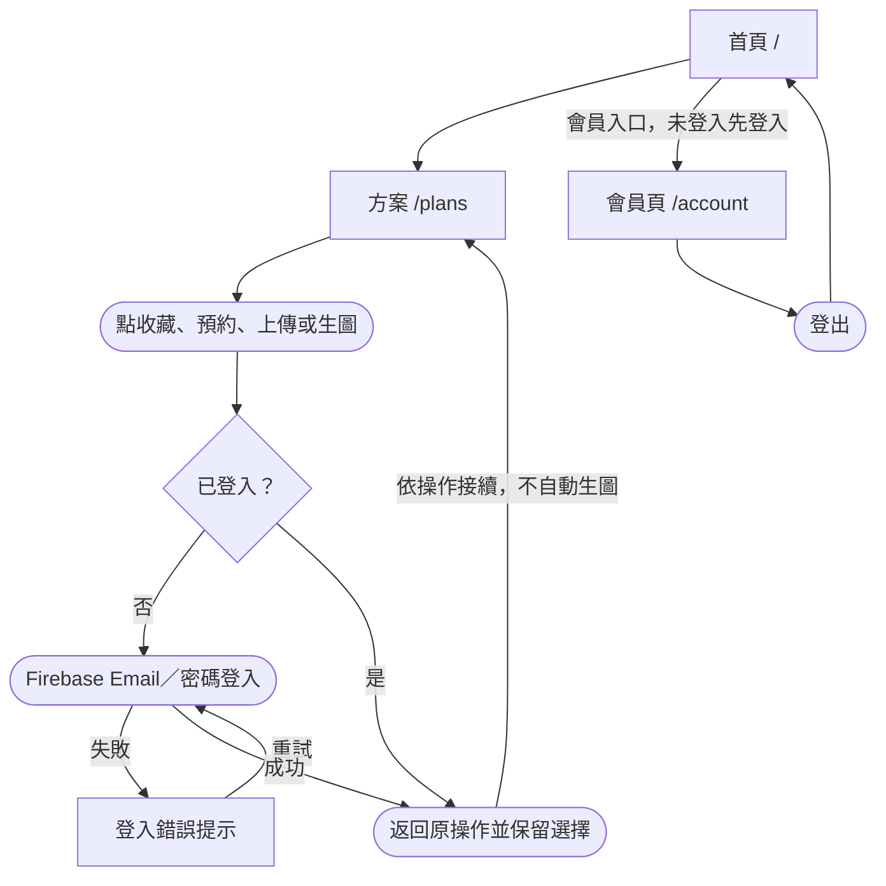
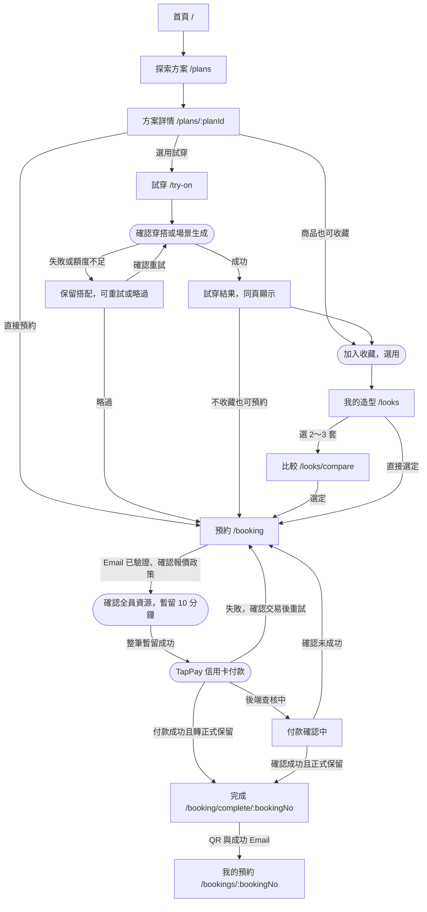
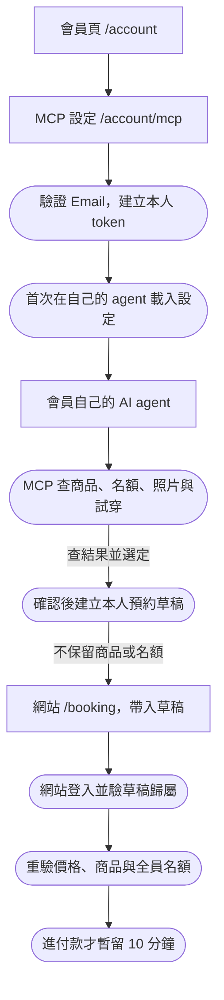
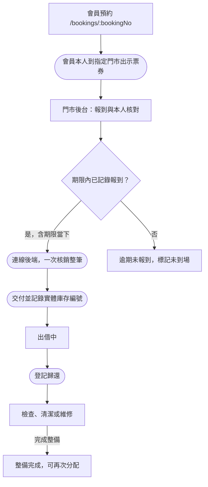

# KINU TABI｜頁面路由與使用者流程圖

更新：2026-10-16。依[最新會員體驗](./04-member-flow-decisions.md)、[產品規劃](./01-product-experience.md)與[API 開發表](./06-api-routes.md)整理；這是待實作規劃，不表示頁面或 API 已完成。

這類圖稱為 **使用者流程圖（User Flow）／頁面路由流程圖**。頁面用方框、操作用圓角節點、條件用菱形，箭頭表示跳轉或狀態回饋。樹狀圖／網站地圖主要呈現上下層關係；這份流程有返回、失敗與分支，適合流程圖。

方框中的 `/plans`、`/booking` 是 React 前端頁面路徑；`GET /api/plans` 是後端 API。一個頁面可呼叫多個 API，不需要一頁對一支 API。

## 圖一：登入、返回原位置與登出

登入可以用共用彈窗或獨立頁，現行規格未固定 `/login`，因此不自行宣告已有這條頁面路由。登入成功回原入口，不一律送到會員頁。錯誤在登入介面提示，不為了仿照範例額外增加 `/ohoh`。圖中「返回方案」代表原入口的例子，試穿／收藏／預約入口也須保留自己的返回位置。

## 圖二：方案、試穿、收藏與預約

前提：需要會員權限的操作套用圖一；匿名可公開瀏覽與比較外拍方案。

- 試穿與收藏是可選操作，不是預約前提；本人照片可改用商店模特兒，所有即時生成仍先登入並確認。
- 場景可在試穿／商品／收藏入口接續；預製圖可直接用於符合規則的場景合成。詳細圖片與配件分支依原體驗文件，本圖不重複展開。
- 報價或全員庫存／名額不足時留在預約流程提示修正，不能進付款。草稿及收藏不保留資源。
- 付款確認中不直接釋放；已扣款但無法成立預約時進處理通知及全額退款，不走成功頁。

## 圖三：外部 AI agent 與 MCP 草稿回網站

`/booking` 如何攜帶 draftId（例如查詢參數）是實作契約，現有文件未固定新頁路徑；連結不放 MCP token。token 不能當網站登入憑證。已設定 agent 後可直接使用，撤銷／重建／刪帳後舊 token 即失效。

MCP 每日 3 次、同時 1 個任務，圖片當天日本午夜刪除且不入網站收藏；網站每日 5 次、圖完成起 7 天。agent 照片處理同意及每次生成確認分開；正式付款、取消、退款與核銷回網站／授權後台。

## 圖四：到店報到、核銷與歸還

以下後台方框是畫面功能名稱，**尚未固定前端 `/admin/...` 頁面路徑**；後端 API 已列於 API 開發表。

報到期限為日本時間預約開始後 30 分鐘（含），期限內先記錄報到，排隊後仍可核銷。QR 每 5 分鐘更新，不能代替本人核對或延長報到期限。跨門市、重複核銷及取消預約票券均拒絕；部分旅客未到場留紀錄，不拆票。未到場解除商品保留後須由門市確認才恢復分配，核銷也不等於庫存立即可用。

## 頁面與 API 對照

| 前端頁面／操作 | 主要呼叫的後端 API |
|---|---|
| `/plans`、`/plans/:planId` | `GET /api/plans`、`GET /api/plans/{planId}`、商品與配件目錄 |
| `/try-on` | sessions、upload-url、validate、generations、jobs；場景與額度查詢 |
| `/looks` | `GET/POST /api/looks`、`PATCH/DELETE /api/looks/{lookId}` |
| `/looks/compare` | `POST /api/plans/compare`，帶 2～3 筆本人搭配識別 |
| `/booking` | booking-drafts、pricing/quote、availability/holds、`POST /api/bookings` |
| 付款確認中介面 | `GET /api/orders/{orderNo}`；尚未成立時不使用不存在的 bookingNo |
| `/booking/complete/:bookingNo`、`/bookings/:bookingNo` | `GET /api/bookings/{bookingNo}`、voucher、取消試算／取消 |
| `/account`、`/account/mcp` | account、generation-usage、mcp-config、mcp-token 管理 |
| 門市後台報到核銷 | admin/bookings、check-in、vouchers/redeem |
| 門市後台出借歸還 | rentals、return、inventory |

表內縮寫對應完整路徑見 [06 API Route 開發表](./06-api-routes.md)。本圖只展開主要旅程，取消、退款、刪帳及全部失敗情境仍依原產品與技術規格，不因省略而取消需求。
